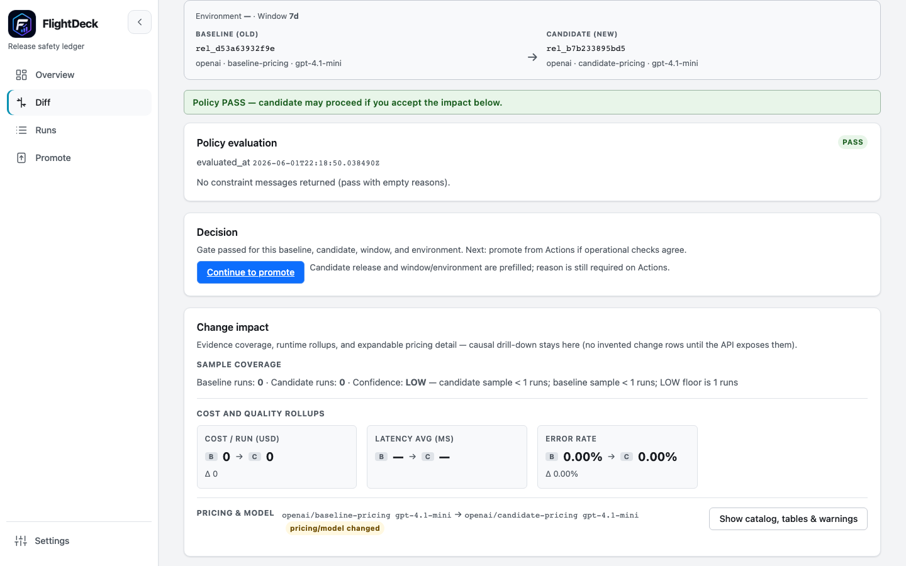
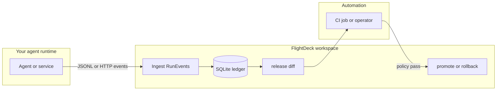
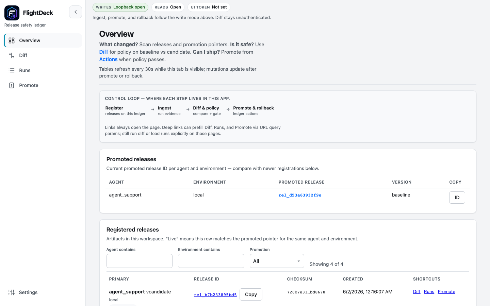
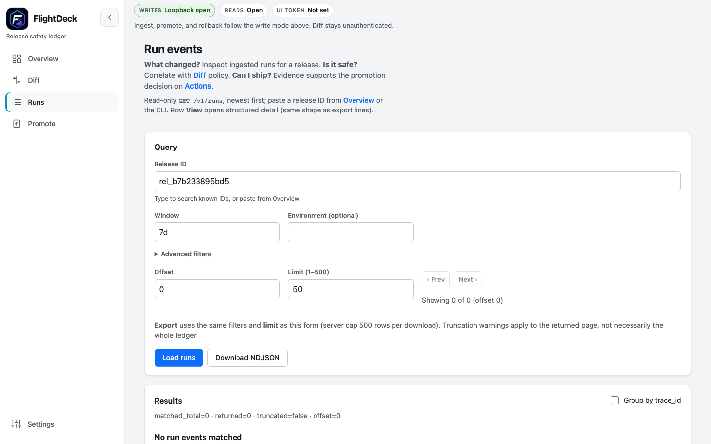
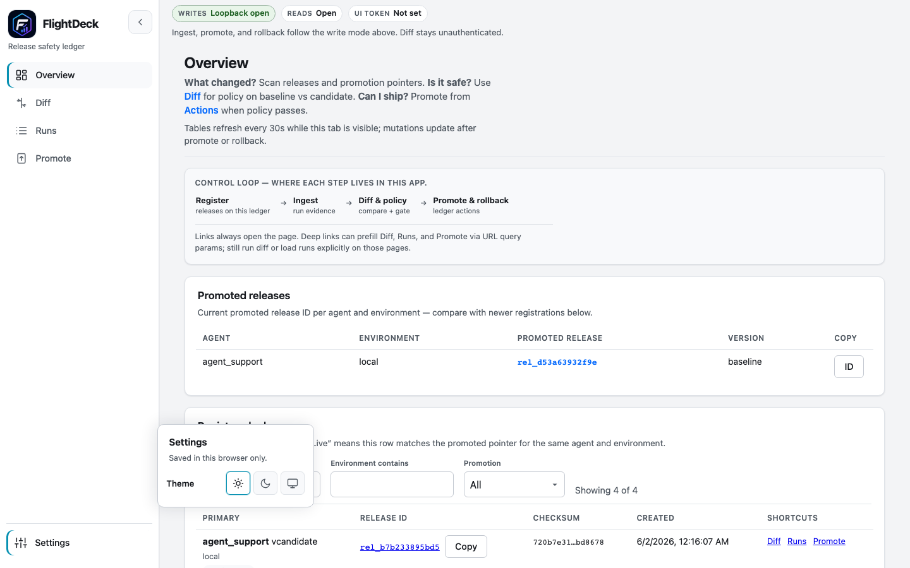

# FlightDeck

[](https://pypi.org/project/flightdeck-ai/) [](https://pypi.org/project/flightdeck-ai/) [](https://github.com/flightdeckdev/flightdeck/actions/workflows/ci.yml) [](https://flightdeckdev.github.io/flightdeck/) [](LICENSE) [](https://github.com/flightdeckdev/flightdeck) [](https://github.com/astral-sh/ruff)

**Ship AI agents safely with release diffs, runtime evidence, and policy gates.**

Local-first **CLI + SQLite**. Optional **`flightdeck serve`** exposes a web UI and **`/v1`** HTTP API — data stays on your machine unless you change that.

> **Try it in 30 seconds:**
> ```bash
> pip install flightdeck-ai
> flightdeck demo
> ```

---

## What it does

You tag an agent build as a **release**, collect runtime evidence (cost, latency, errors), **diff** a baseline against a candidate, and **promote** only when policy says the numbers are acceptable.

| | FlightDeck | Tracing SaaS (LangSmith, Langfuse) | Git / CI alone |
|--|---|---|---|
| **Focus** | Release + promote governance | Session traces + evals | Source + pipelines |
| Versioned release artifact | ✅ | ✗ | DIY |
| Cost / latency / error diff | ✅ | Different lens | DIY |
| Policy gate blocks promote | ✅ | ✗ | DIY |
| Audit ledger (who promoted what) | ✅ | ✗ | ✗ |
| Local-first, no SaaS required | ✅ | ✗ | ✅ |

FlightDeck is not a replacement for tracing — it sits **after** traces and evals, at the **release boundary**.

---

## Demo

[](docs/screenshots/flightdeck-demo.webm)

*Policy PASS verdict after a baseline vs candidate diff. [Watch the full walkthrough](docs/screenshots/flightdeck-demo.webm)*

---

## Quick start

```bash
pip install flightdeck-ai   # or: uv tool install flightdeck-ai
flightdeck demo             # end-to-end: register → ingest → diff → promote
```

`flightdeck demo` runs entirely in a disposable temp workspace — no account, no setup.

**Web UI** (optional — adds a local HTTP server + React dashboard):

```bash
flightdeck init
flightdeck serve            # opens http://127.0.0.1:8765/
```

---

## Integrate with your agent

Drop this into your existing OpenAI agent to start sending evidence:

```python
from flightdeck.integrations.openai_chat import FlightDeckOpenAIIntegration

fd = FlightDeckOpenAIIntegration(
    server_url="http://127.0.0.1:8765",
    release_id="rel_<your-release-id>",  # from: flightdeck release register ./build
)

# wrap your existing OpenAI call — FlightDeck records cost, latency, success
response = fd.chat_completions_create(client, model="gpt-4o-mini", messages=[...])
```

Works with **Anthropic, LangChain, OpenAI Agents SDK, Temporal, and OpenTelemetry** — see [docs/sdk-integrations.md](docs/sdk-integrations.md).

---

## Outbound webhooks

Get notified in Slack, Discord, or PagerDuty when a release is promoted, rolled back, or blocked:

```bash
flightdeck webhook add \
  --url https://hooks.slack.com/services/T000/B000/XXXX \
  --event promote.succeeded --event rollback.succeeded \
  --description "prod release alerts"

flightdeck webhook list
flightdeck webhook test wh_<id>
```

Payloads are signed with `HMAC-SHA256` (`X-FlightDeck-Signature: sha256=<hex>`). Full guide including Discord / PagerDuty / Linear adapters: [docs/sdk-integrations.md#outbound-webhooks](docs/sdk-integrations.md#outbound-webhooks--slack-discord-pagerduty-linear-).

---

## Who should use this?

- **Platform / ML engineering teams** shipping LLM agents to production who want a governed promote path — not just a trace dashboard.
- **Regulated teams** (fintech, healthcare) where data residency, audit trails, and local-first defaults matter. Self-host `flightdeck serve` to keep data on-prem.
- Engineers who want to answer **"is this candidate safe to ship?"** with numbers and policy, not gut feel.

---

## How it fits your stack



---

## CLI example (policy + pricing)

```bash
flightdeck init
flightdeck pricing import examples/quickstart/pricing-baseline.yaml
flightdeck pricing import examples/quickstart/pricing-candidate.yaml
flightdeck policy set examples/quickstart/policy.yaml

BASELINE=$(flightdeck release register examples/quickstart/baseline-release)
CANDIDATE=$(flightdeck release register examples/quickstart/candidate-release)

flightdeck runs ingest baseline-events.jsonl
flightdeck runs ingest candidate-events.jsonl

flightdeck release diff "$BASELINE" "$CANDIDATE" --window 7d
flightdeck release promote "$BASELINE" --env local --window 7d --reason "baseline"
flightdeck release history --agent agent_support --env local
```

More: [examples/quickstart/](examples/quickstart/) · [examples/ci/](examples/ci/) · [examples/deploy/](examples/deploy/)

---

## Documentation

**[flightdeckdev.github.io/flightdeck](https://flightdeckdev.github.io/flightdeck/)** — full reference, auto-updated on every push to `main`.

| Area | Link |
|------|------|
| CLI reference | [docs/cli.md](docs/cli.md) |
| HTTP API | [docs/http-api.md](docs/http-api.md) |
| Security / trust model | [SECURITY.md](SECURITY.md) |
| Python SDK | [docs/sdk.md](docs/sdk.md) |
| Policy, diff, promote | [docs/operations-and-policy.md](docs/operations-and-policy.md) |
| Release artifact schema | [docs/release-artifact.md](docs/release-artifact.md) |
| Pricing catalog | [docs/pricing-catalog.md](docs/pricing-catalog.md) |
| SDK integrations | [docs/sdk-integrations.md](docs/sdk-integrations.md) |
| Web UI | [docs/web-ui.md](docs/web-ui.md) |

---

## Screenshots

| Overview — ledger at a glance | Diff — policy verdict + cost delta |
|---|---|
|  |  |

| Runs — forensic filter with datalist | Dark mode |
|---|---|
|  |  |

---

## Contributing

```bash
uv sync --frozen --extra dev
uv run python -m ruff check src tests
uv run python -m pytest
uv run flightdeck demo
```

Full CI gates (web bundle, schema drift, Playwright e2e): [DEVELOPMENT.md](DEVELOPMENT.md)

---

## License

Apache-2.0 — [LICENSE](LICENSE) · [NOTICE](NOTICE)

Canonical: [github.com/flightdeckdev/flightdeck](https://github.com/flightdeckdev/flightdeck)
